# SI-Stars (Super Intelligence Stars!)

**SI-Stars** is a continuous-time 4X space strategy game (with active pause and variable speed `1x–20x`), inspired by *Stars!* (1995). It is designed both for browser-based gameplay (Rust → WebAssembly + TypeScript/Vite + WebGPU), high-throughput headless AI-vs-AI policy simulation, and an HTTP/WebSocket + MCP Arena Server where LLM agents compete against each other and built-in AI Governors.

## Screenshots

<table>
  <tr>
    <td align="center" width="50%">
      <a href="docs/screenshots/shot-10.png">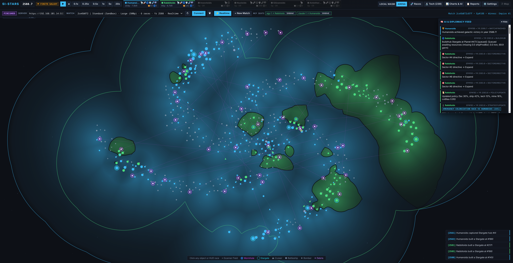</a><br/>
      <sub><b>LLM vs LLM Arena Match</b> — Claude (Humanoids) vs Antigravity (Rabbitoids) with live AI &amp; Diplomacy Feed</sub>
    </td>
    <td align="center" width="50%">
      <a href="docs/screenshots/shot-09.png">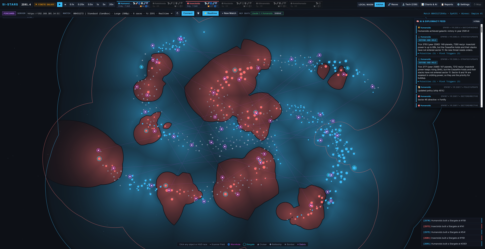</a><br/>
      <sub><b>AI Agent vs Governors</b> — WebGPU scanner equilibrium fields, wormhole links &amp; strategic reasoning</sub>
    </td>
  </tr>
  <tr>
    <td align="center" width="50%">
      <a href="docs/screenshots/shot-06.png">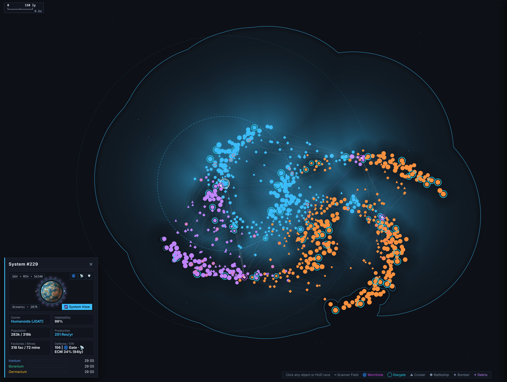</a><br/>
      <sub><b>Spiral Galaxy &amp; System Inspector</b> — WebGPU scanner contours, Stargates &amp; fuel range overlays</sub>
    </td>
    <td align="center" width="50%">
      <a href="docs/screenshots/shot-07.png">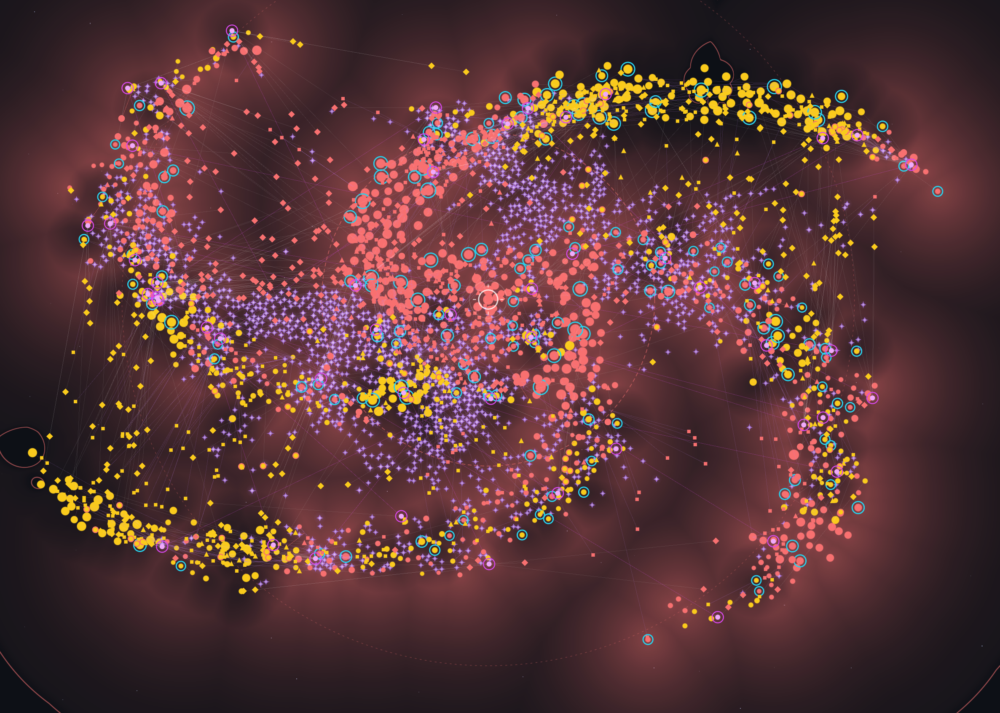</a><br/>
      <sub><b>Mid-Game Galactic War</b> — Hundreds of fleets in transit, Stargate networks &amp; contested borders</sub>
    </td>
  </tr>
  <tr>
    <td align="center" width="50%">
      <a href="docs/screenshots/shot-05.png">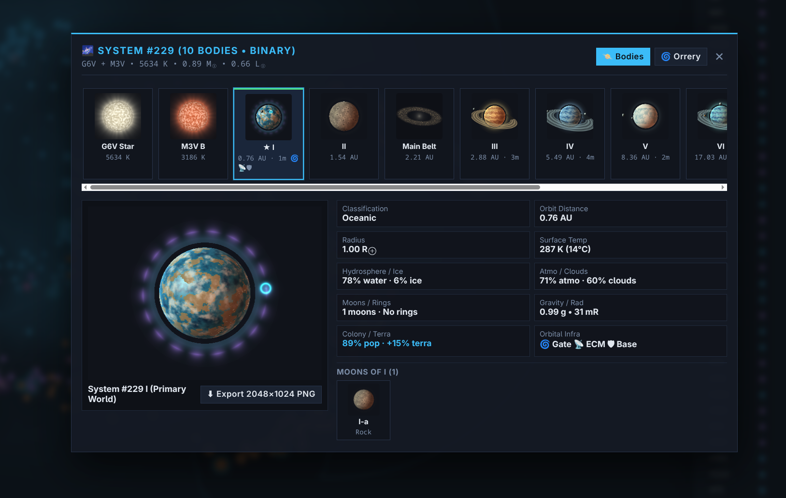</a><br/>
      <sub><b>Binary Star System View</b> — Procedural 3D world with orbital infrastructure &amp; moon</sub>
    </td>
    <td align="center" width="50%">
      <a href="docs/screenshots/shot-02.png">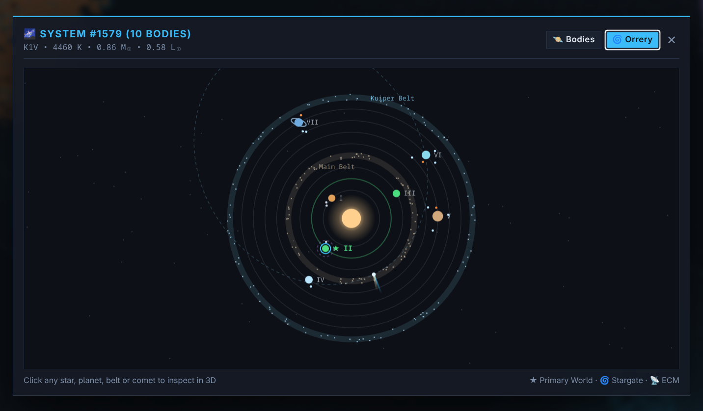</a><br/>
      <sub><b>2D System Orrery</b> — Planetary orbits, Main &amp; Kuiper belts, eccentric comet &amp; Stargate</sub>
    </td>
  </tr>
  <tr>
    <td align="center" width="50%">
      <a href="docs/screenshots/shot-08.png">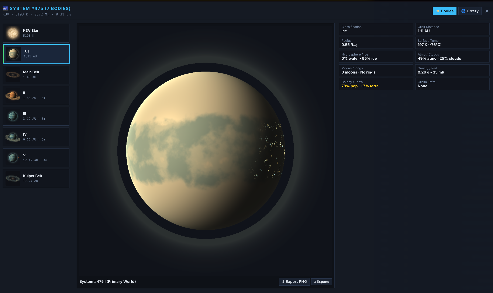</a><br/>
      <sub><b>Procedural 3D Planet</b> — Ice world with atmospheric clouds &amp; night-side colony lights</sub>
    </td>
    <td align="center" width="50%">
      <a href="docs/screenshots/shot-01.png">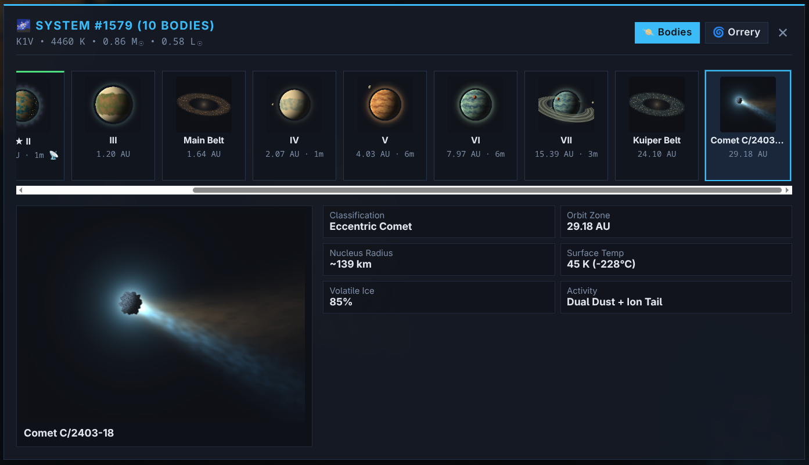</a><br/>
      <sub><b>Eccentric Comet</b> — Dual dust &amp; ion tail inside the System Inspector</sub>
    </td>
  </tr>
  <tr>
    <td align="center" width="50%">
      <a href="docs/screenshots/shot-03.png">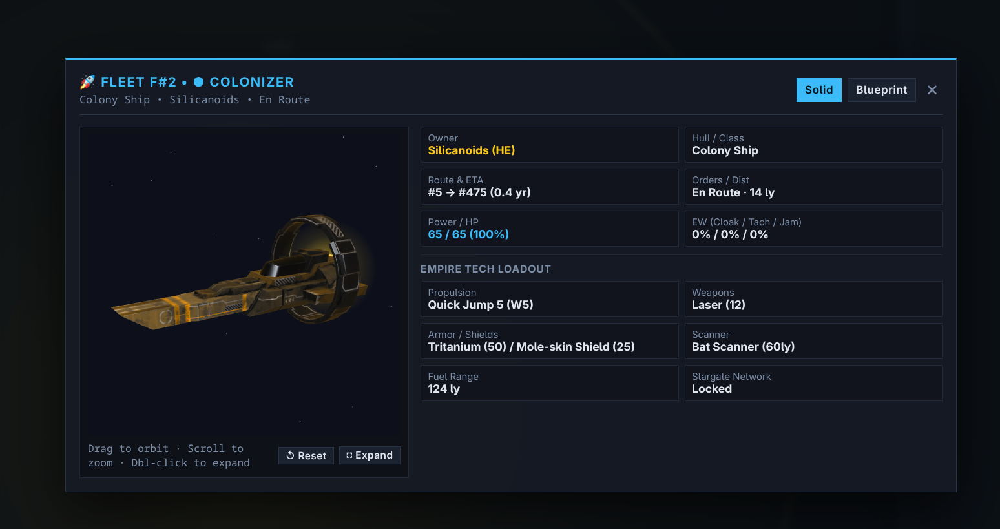</a><br/>
      <sub><b>3D Fleet Inspector</b> — Interactive 3D hull preview, route ETA &amp; empire tech loadout</sub>
    </td>
    <td align="center" width="50%">
      <a href="docs/screenshots/shot-04.png">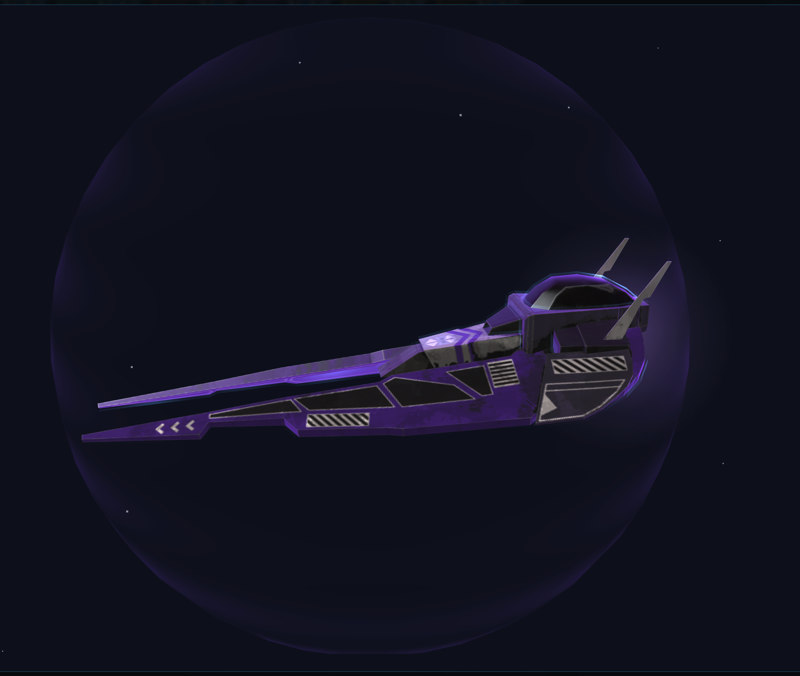</a><br/>
      <sub><b>Stealth &amp; Shield FX</b> — Close-up 3D hull with translucent energy shield bubble</sub>
    </td>
  </tr>
  <tr>
    <td align="center" colspan="2">
      <a href="docs/screenshots/shot-11.png">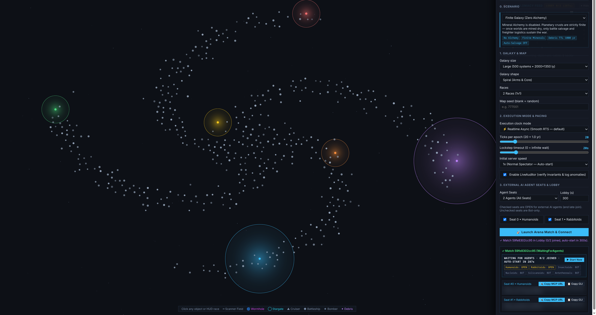</a><br/>
      <sub><b>Arena Match Lobby</b> — Scenario presets, external AI seat configuration &amp; 300s auto-start countdown</sub>
    </td>
  </tr>
</table>

## Repository Structure

```text
sistars/
├── crates/
│   └── engine/           # Deterministic headless Rust simulation engine + WASM bindings
│       ├── src/
│       │   ├── lib.rs    # Crate entry point
│       │   ├── config.rs # Simulation config, 6 tech fields, breakthroughs, ship designs
│       │   ├── types.rs  # Core data structures, AI doctrines, snapshots
│       │   ├── sim.rs    # Deterministic simulation loop (SoA planets, fleets, combat)
│       │   ├── ai.rs     # Monte Carlo tournaments, co-evolution, auto-balancing
│       │   ├── wasm.rs   # wasm-bindgen browser bridge (wasm32 only)
│       │   └── bin/
│       │       └── headless.rs # Native headless benchmark & tournament CLI
│       └── Cargo.toml
├── web/                  # Browser frontend (TypeScript + Vite + Canvas)
│   ├── src/
│   │   ├── main.ts       # App bootstrap, WASM integration, animation loop
│   │   ├── types.ts      # TypeScript interfaces matching engine snapshots
│   │   ├── renderer.ts   # Galaxy map Canvas renderer & visual FX
│   │   ├── ui.ts         # HUD, Planet Inspector, Event Log, and 4 slide-out drawers
│   │   └── style.css     # Dark tactical HUD styles
│   ├── index.html
│   ├── package.json
│   ├── tsconfig.json
│   └── vite.config.ts
├── data/
│   └── craig-stars/      # Unmodified upstream tech & rule definitions from craig-stars
├── AGENTS.md             # Repository engineering guidelines
├── SPEC.md               # Project specification
└── LICENSE               # MIT License
```

## Prerequisites

- **Rust toolchain:** `rustc`, `cargo`, `rustup` with target `wasm32-unknown-unknown`
- **WASM build tool:** `wasm-pack` (`cargo install wasm-pack --locked`) and `binaryen` (`wasm-opt`)
- **Frontend toolchain:** `node` (v20+) and `npm`

On Ubuntu:
```bash
sudo apt install -y pkg-config libssl-dev npm binaryen
rustup target add wasm32-unknown-unknown
cargo install wasm-pack --locked
```

## Running & Building

### 1. Native Rust Engine (Tests & Headless Benchmark)
```bash
cargo test
cargo run --release --bin headless
```

### 2. WebAssembly + Frontend (Browser)
```bash
# Build WASM package into web/src/wasm
wasm-pack build crates/engine --target web --out-dir ../../web/src/wasm

# Install frontend dependencies and start Vite dev server
cd web
npm install
npm run dev
```

Or build the full production bundle:
```bash
cd web
npm run build
```

### 3. Arena Match Replays
The arena server records every match as a replay: the initial state (seed, config, races, engine commit), every action (agent orders and notes, agent join/leave, governor decisions) and a state hash every 100 ticks. Positions or per-tick state are not stored; the deterministic engine reproduces them.

- Written once when the match ends (victory, admin abort, `DELETE`, or server Ctrl+C / SIGTERM) to `$SISTARS_REPLAYS_DIR` (default `$SISTARS_LOGS_DIR/replays`, i.e. `logs/replays`) as `match_<id>.replay.jsonl.gz` (gzip JSONL, ~40–50 KB per full match).
- Download: `GET /api/v1/matches/{id}/replay` (also after the match was deleted).
- Verify / analyse with the current engine:
  ```bash
  cargo run --release --bin headless -- --replay logs/replays/match_<id>.replay.jsonl.gz \
      [--until-tick N] [--audit] [--dump-state state.json]
  ```
  It reports `OK` or the first divergence (tick, empire, recorded vs replayed governor action, or state hash). Replays always run on the current code; for a bit-exact rerun of an old match, check out the `engineCommit` from its header.

An admin can end a stuck match with `POST /api/v1/matches/{id}/control {"abort": true}` (or the **⏹ Abort** button in the arena bar): status becomes `Aborted` with no winner. Abort and `DELETE` require `SISTARS_ADMIN_TOKEN` when it is set; agents cannot trigger them.

## External Data & Attribution

### 1. Game Data (`data/craig-stars/`)
Static game data files stored unmodified under `data/craig-stars/` (`techs.json`, `rules.json`, and `LICENSE`) are imported from the **[craig-stars](https://github.com/sirgwain/craig-stars)** project:

- **Source Repository:** <https://github.com/sirgwain/craig-stars>
- **Upstream Files:** `frontend/src/lib/ssr/techs.json`, `frontend/src/lib/ssr/rules.json` (commit `943ffaea1dd2455180e0054efd420f4c4ff00b85`)
- **Author:** `sirgwain`
- **License:** MIT License

### 2. 3D Spaceship Models (`web/public/models/ships/`)
The low-poly 3D ship hulls (`battleship.glb`, `cruiser.glb`, `bomber.glb`, `freighter.glb`, `colony.glb`) are derived from the **Ultimate Spaceship Pack** by **Quaternius**:

- **Author:** Quaternius (<https://quaternius.com>)
- **License:** CC0 1.0 Universal (Public Domain Dedication) — see `web/public/models/ships/LICENSE-Quaternius-CC0.txt`

```text
MIT License

Copyright (c) 2022 sirgwain

Permission is hereby granted, free of charge, to any person obtaining a copy
of this software and associated documentation files (the "Software"), to deal
in the Software without restriction, including without limitation the rights
to use, copy, modify, merge, publish, distribute, sublicense, and/or sell
copies of the Software, and to permit persons to whom the Software is
furnished to do so, subject to the following conditions:

The above copyright notice and this permission notice shall be included in all
copies or substantial portions of the Software.

THE SOFTWARE IS PROVIDED "AS IS", WITHOUT WARRANTY OF ANY KIND, EXPRESS OR
IMPLIED, INCLUDING BUT NOT LIMITED TO THE WARRANTIES OF MERCHANTABILITY,
FITNESS FOR A PARTICULAR PURPOSE AND NONINFRINGEMENT. IN NO EVENT SHALL THE
AUTHORS OR COPYRIGHT HOLDERS BE LIABLE FOR ANY CLAIM, DAMAGES OR OTHER
LIABILITY, WHETHER IN AN ACTION OF CONTRACT, TORT OR OTHERWISE, ARISING FROM,
OUT OF OR IN CONNECTION WITH THE SOFTWARE OR THE USE OR OTHER DEALINGS IN THE
SOFTWARE.
```

## License

SI-Stars is licensed under the MIT License. See [LICENSE](LICENSE) for details.
